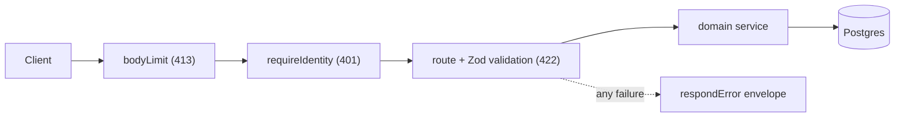

# Architecture

This service is a Hono HTTP API. Route files declare each endpoint's schemas with `createRoute`, and the same declarations produce the OpenAPI document and the runtime validation. Handlers call a service in `src/domain/<feature>/`, and the service talks to Postgres through Drizzle. One Hono app, built by `createApp`, runs on Bun by default and on Node.js through a second entry point.

## How a request flows

`/health`, `/doc` and `/reference` skip the identity step. Every other route group needs it.

## Code map

Reuse these before you write something similar.

| Path | Responsibility | Reuse, don't recreate |
| --- | --- | --- |
| `src/index.ts` | Bun entry point; sets body size and idle timeout. | — |
| `src/node.ts` | Node.js entry point; sets header and request timeouts. | — |
| `src/app.ts` | `createApp` wires middleware, routes, `/doc`, `/reference` and the 404 and 500 handlers. | Add new route groups here. |
| `src/api/errors.ts` | The error envelope. | `respondError` writes any error. `errorResponse` declares an error in a route's `responses`. |
| `src/api/middleware/identity.ts` | Resolves the caller or returns 401. | `requireIdentity` guards a route group; read the caller with `c.get("ownerId")`. |
| `src/api/middleware/jwt.ts` | Validates Bearer JWTs against the product's JWKS. | `requireJwt` guards a route group when `JWKS_URL` is set; `sub` becomes `ownerId`. |
| `src/api/routes/<feature>.ts` | Thin handlers and `createRoute` contracts. | `notes.ts` is the pattern; `toNoteResponse` maps a row to JSON. |
| `src/domain/<feature>/schema.ts` | Drizzle table. | — |
| `src/domain/<feature>/schemas.ts` | Zod request and response schemas. | Derive types with `z.infer`. |
| `src/domain/<feature>/service.ts` | Queries, always filtered by `ownerId`. | Call it from handlers; never query from a route. |
| `src/core/config.ts` | The only reader of `process.env`. | Add a variable to the schema and to `.env.example`. |
| `src/core/database.ts` | Postgres client and Drizzle instance. | Import `db`. |
| `drizzle/` | Generated migrations. | — |
| `openapi/openapi.json` | The committed API contract. | Regenerate with `make openapi` after any route change. |
| `openapi/client/` | Generated typed client. | Import it in API consumers; never edit it by hand. |
| `scripts/openapi.mjs` | Spec export, client generation and the spec-diff check. | Run through `make openapi` and `make spec-diff`. |
| `scripts/repo-policy.mjs` | Layout, docs, ledger and drift checks. | Configure it in `scripts/repo-policy.json`. |
| `scripts/agent-hook.mjs` | Format and verify hooks for coding agents. | — |
| `.ast-grep/rules/` | Anti-slop and boundary rules. | Add a rule and a test in `.ast-grep/tests/`. |

## Invariants

- Only `src/core/config.ts` reads `process.env`. [enforced by ast-grep]
- No empty function or arrow-function stubs. [enforced by ast-grep]
- Every directory is listed in `scripts/repo-policy.json`. [enforced by `make policy`]
- Every dependency has a row in `docs/dependencies.md`. [enforced by `make policy`]
- The Postgres image tag is the same in `compose.yaml` and the workflows. [enforced by `make policy`]
- Every `/notes` query filters by the caller's `ownerId`. [enforced by tests]
- Requests without a trusted identity get 401. [enforced by tests]
- Bearer tokens are verified against the configured JWKS, including issuer, audience and expiry. [enforced by tests]
- Every error body is the shared envelope. [enforced by tests]
- Routes declare request and response schemas with `createRoute`. [review-only]
- The committed OpenAPI spec and client match the routes. [enforced by `make spec-diff`]
- Handlers contain no business logic. [review-only]

## Cross-cutting concerns

| Concern | How it works |
| --- | --- |
| Config | `src/core/config.ts` parses the environment with Zod at startup and exports a typed `config`. A bad value stops the process. |
| Errors | `respondError` returns `{"error": {"message", "status", "details?"}}`. Validation failures use 422 with Zod issues in `details`. Unexpected errors log server-side and return `Internal Server Error`. |
| Auth | `requireIdentity` reads `x-user-id` only when `TRUST_IDENTITY_HEADER` is `true`. It returns 401 otherwise. The header is a stand-in for real authentication. When `JWKS_URL` is set, `requireJwt` validates Bearer tokens instead and the env schema still refuses the dev flag in production. |
| Limits | `bodyLimit` rejects bodies over `MAX_BODY_BYTES` with 413. Both entry points set server timeouts. |
| Logging | Handlers log with `console`; unexpected errors are logged once in the 500 handler. |
| Database | `src/core/database.ts` opens one connection pool. Services use the Drizzle query builder, so values are always parameterized. |
| Migrations | Drizzle Kit generates SQL into `drizzle/`. `make db-push` applies the schema directly for local work and CI. |

## Services

Baseline §1 rows, decided for this backend-only template. A fresh clone runs with
nothing but `.env.example` filled in: `make up` starts the one Postgres container,
`make db-push` applies the schema, `make dev` starts the server.

| Service | Status | How |
| --- | --- | --- |
| Database | In | Plain Postgres through `DATABASE_URL`, Drizzle queries, one Compose container for dev. |
| Auth | In | Dev header stub plus JWT validation against the product's JWKS (`JWKS_URL`). The product's login host lives elsewhere. |
| Hosting | Out | A derived service chooses its host. The template runs on Bun or Node.js with no host API. |
| Email, SMS | Out | No notification glue in the template; the product composes providers behind its own API. |
| Payments, AI, files | Out | Same: product features, not template features. No provider SDK is pinned here. |
| Analytics, errors, uptime | Out | The product wires PostHog, Sentry and uptime checks; the template exposes `/health` for them. |
